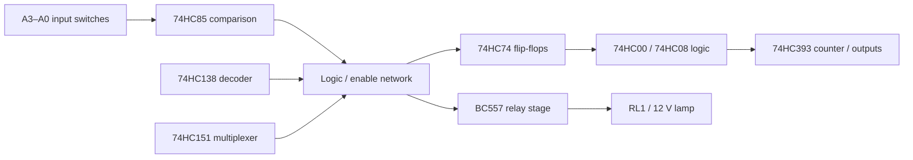

# Circuit architecture

## Functional blocks

*This is a conceptual block diagram, not a verified pin-to-pin netlist. Actual connections must be checked inside Proteus.*

## Observed components

- **U1 / 74HC85:** 4-bit comparator; the equality output `QA=B` is visible.
- **U2 / 74HC138:** decoder with labeled outputs `Y0` and `Y1`.
- **U3 / 74HC151:** multiplexer, with a mode selection shown.
- **U4 / 74HC74:** two D flip-flop sections used for stored state.
- **U5 / 74HC00 and U7 / 74HC08:** NAND and AND logic.
- **U6 / 74HC393:** binary counter with shown `Q0`/`Q1` signals.
- **Q1 / BC557 and RL1:** transistor / electromechanical switching stage.
- **L1:** 12 V indicator lamp as a load.

## Design intent

The demonstration passcode is binary `1011`, represented by `A3 A2 A1 A0`. A robust implementation should compare the full four-bit candidate input to the configured code, latch a successful entry only on an appropriate Enter event, reset reliably, and drive an indicator or relay only after authorization.

**Caution:** The supplied screenshots do not, by themselves, prove all these requirements are correctly implemented. In particular, the actual four-bit reference inputs of the comparator and the relay driver wiring should be verified in Proteus.

## Useful checks

- Confirm that VCC for each 74HC IC is a regulated voltage within its datasheet limits; a 9 V battery is not automatically a safe 74HC logic supply.
- Confirm that the BC557 drive and relay-coil wiring are appropriate for a PNP high-side switch (if that is the intended topology).
- Provide a flyback diode across a physical DC relay coil, correct polarity for the chosen topology.
- Ensure all logic inputs have defined HIGH or LOW levels and that any asynchronous flip-flop set/reset inputs are correctly biased.
