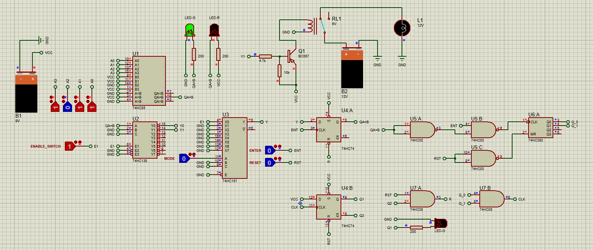
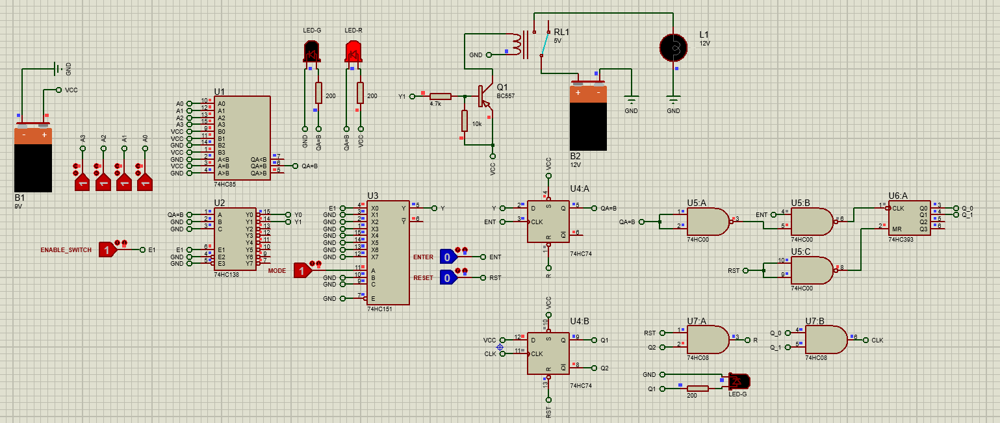

# Password-Protected Security System

**A digital-logic access-control circuit designed in Proteus.**






## Overview

This educational security-system project explores a **4-bit password input**, combinational logic, state storage, and a transistor-driven relay output. The access code used in the supplied demonstration is **`1011`** (binary). The supplied screenshots show different circuit states in the Proteus simulation.

The project uses logic ICs instead of a microcontroller. It is intended as a teaching and portfolio demonstration, **not** a hardened physical access-control product.

> **Security note:** `1011` is a publicly documented **demonstration code**, not a secret. The four-bit input space has only 16 possible combinations. Do not use this design as-is to secure physical assets.

## Features

- Four manually controlled digital inputs (`A3`, `A2`, `A1`, `A0`)
- A four-bit magnitude comparator (`74HC85`)
- Decoder and multiplexer stages (`74HC138`, `74HC151`)
- State storage (`74HC74` D flip-flops)
- NAND/AND logic and digital count/state indicators (`74HC00`, `74HC08`, `74HC393`)
- LEDs for visual feedback
- A BC557 transistor and 5 V relay model switching a 12 V lamp in the depicted circuit
- Enter, reset, enable, and mode input controls shown in the screenshots

**Verification boundary:** The statements above describe the *visible circuit components and intended demonstration*. Operation, wiring correctness, password enforcement, and safe relay-drive behavior have **not** been independently verified by running Proteus.

## Circuit preview

| Input/state screenshot 1 | Input/state screenshot 2 |
|:---:|:---:|
|  |  |

## Component overview

| Component | Reference(s) | Purpose in design |
|---|---|---|
| 74HC85 | U1 | Compares two 4-bit inputs |
| 74HC138 | U2 | 3-to-8 decoding |
| 74HC151 | U3 | 8-to-1 selection/multiplexing |
| 74HC74 | U4 | Flip-flop state storage |
| 74HC00 | U5 | NAND logic |
| 74HC393 | U6 | Binary counter |
| 74HC08 | U7 | AND logic |
| BC557 | Q1 | Relay drive stage (requires verification) |
| 5 V relay | RL1 | Switching element |
| 12 V lamp | L1 | Demonstration load |
| LEDs, resistors, digital switches | Various | Input, indication and control |
| 9 V and 12 V sources | B1, B2 | Sources shown in schematic; verify IC and relay supply rails |

For the logical blocks, see [Circuit architecture](docs/CIRCUIT_ARCHITECTURE.md).

## Getting started

1. Install a Proteus version compatible with the supplied `.pdsprj` file.
2. Download or clone this repository.
3. Open [`proteus/Password_Protected_Security_System.pdsprj`](proteus/Password_Protected_Security_System.pdsprj).
4. Confirm that all the devices and component libraries resolve in Proteus.
5. Inspect all supply rails and the relay driver before running the simulation.
6. Run the simulation and use the four digital input switches to demonstrate the binary input.
7. Test `A3 A2 A1 A0 = 1 0 1 1` and record the output behavior.
8. Compare results with [the test checklist](docs/TESTING.md). Do not assume an unlock state without verifying it.

### Binary input example

```text
A3  A2  A1  A0
 1   0   1   1     (demonstration code: 1011)
```

Depending on the exact switches or comparator wiring, you may need to inspect and confirm which levels are interpreted as correct in the schematic.

## Repository layout

```text
Password-Protected-Security-System/
├── README.md
├── .gitignore
├── proteus/
│   └── Password_Protected_Security_System.pdsprj
├── images/
│   ├── security-system-state-01.png
│   └── security-system-state-02.png
└── docs/
    ├── CIRCUIT_ARCHITECTURE.md
    ├── TESTING.md
    └── SAFETY_AND_LIMITATIONS.md
```

## Project notes

This project documents the supplied Proteus design and screenshots without inventing a successful simulation test. If any output does not behave as intended, review the decoder/multiplexer select and enable pins, flip-flop clock/reset wiring, and relay drive stage.

For detailed caveats, see [Safety and limitations](docs/SAFETY_AND_LIMITATIONS.md).

## Authorship and rights

Project files and images supplied by the project owner. **No open-source license is granted by this repository by default.** Public visibility permits viewing; reuse, modification and redistribution require permission unless a license is added.
